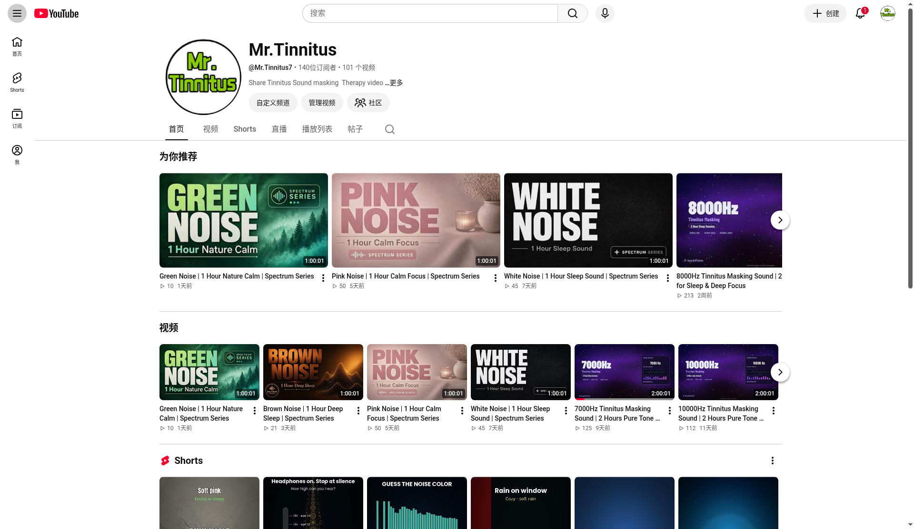
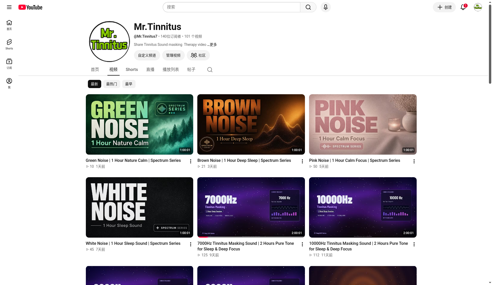

# Tinnitus Relief Audio

Free **tinnitus relief ASMR** and calm sleep sounds for people who deal with ringing in the ears.

This project collects English-friendly tinnitus relief audio ideas, playlists, and listening notes so searchers looking for **Tinnitus ASMR**, **tinnitus relief sounds**, and **sleep sounds for tinnitus** can find a clear starting point.

## Listen on YouTube

Channel: **[Mr.Tinnitus](https://www.youtube.com/@Mr.Tinnitus7)**

Long-form tinnitus relief / ASMR-style calm audio for focus, sleep, and quieter evenings.

## Telegram

Channel: **[MrTinnitusASMRAudio](https://t.me/MrTinnitusASMRAudio)**

Daily free tinnitus relief ASMR audio on Telegram (@MrTinnitusASMRAudio)

## What you will find here

- English keywords and naming patterns useful for tinnitus ASMR discovery
- Links to free YouTube long-form relief audio
- Simple listening tips for ringing-in-the-ears nights

## Suggested search keywords

- Tinnitus ASMR
- Tinnitus relief sounds
- Sleep sounds for tinnitus
- Calm audio for ringing ears
- White noise for tinnitus
- Soft rain / brown noise tinnitus relief

## Listening tips

1. Keep volume comfortable — loud playback can make symptoms feel worse.
2. Prefer longer tracks (20–60+ minutes) so you do not keep switching.
3. Try brown noise, soft rain, or low fan-style textures if sharp tones bother you.
4. Use headphones or speakers based on what feels gentler for you that day.

## Disclaimer

This repository and the linked videos are for **relaxation and educational information only**. They are **not medical advice**, diagnosis, or treatment. If tinnitus is new, sudden, one-sided, or affects daily life, talk with a qualified hearing or medical professional.

## Related links

- YouTube: https://www.youtube.com/@Mr.Tinnitus7
- Telegram search bot (affiliate): https://t.me/jisou?start=_tgr_SrcelRFlNGM1
- Telegram channel: https://t.me/MrTinnitusASMRAudio

## License

Media on YouTube remains under that platform’s terms. Text in this repo is shared for free public discovery of tinnitus relief audio resources.
